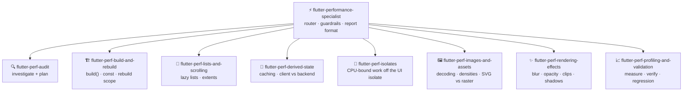

```
███████╗██╗     ██╗   ██╗████████╗████████╗███████╗██████╗ 
██╔════╝██║     ██║   ██║╚══██╔══╝╚══██╔══╝██╔════╝██╔══██╗
█████╗  ██║     ██║   ██║   ██║      ██║   █████╗  ██████╔╝
██╔══╝  ██║     ██║   ██║   ██║      ██║   ██╔══╝  ██╔══██╗
██║     ████████╗╚██████╔╝   ██║      ██║   ███████╗██║  ██║
╚═╝     ╚══════╝ ╚═════╝    ╚═╝      ╚═╝   ╚══════╝╚═╝  ╚═╝
 ██████╗ ██████╗ ████████╗██╗███╗   ███╗██╗███████╗███████╗██████╗ 
██╔═══██╗██╔══██╗╚══██╔══╝██║████╗ ████║██║██╔════╝██╔════╝██╔══██╗
██║   ██║██████╔╝   ██║   ██║██╔████╔██║██║███████╗█████╗  ██████╔╝
██║   ██║██╔═══╝    ██║   ██║██║╚██╔╝██║██║╚════██║██╔══╝  ██╔══██╗
╚██████╔╝██║        ██║   ██║██║ ╚═╝ ██║██║███████║███████╗██║  ██║
 ╚═════╝ ╚═╝        ╚═╝   ╚═╝╚═╝     ╚═╝╚═╝╚══════╝╚══════╝╚═╝  ╚═╝
```

<div align="center">

# ⚡ Flutter Optimiser

**Evidence-based performance skills for AI coding agents**

[](https://github.com/KinwiseNZ-DevOps/flutter-optimiser/actions/workflows/validate.yml)
[](LICENSE)
[](https://agentskills.io)
[](https://agentskills.io/specification)
[](scripts/skills_tool.py)

</div>

> [!IMPORTANT]
> **Principle: inspect first, measure, change only what evidence justifies, preserve all business behaviour.**

A set of agent skills for auditing and optimising **any** production Flutter app, based on Flutter's official performance guidance. One **router skill** plus **eight focused skills**, following the [Agent Skills](https://agentskills.io/specification) open format: drop them into Claude Code, Codex, Cursor, Copilot, OpenCode, or any SKILL.md-compatible agent.

## 🧩 Skills

<!-- catalogue:begin -->
| Skill | Purpose |
|---|---|
| [`flutter-perf-audit`](skills/flutter-perf-audit/SKILL.md) | Runs the investigation and planning phase of a Flutter performance review: maps architecture, state management, data flow, pagination, image strategy and lint rules, finds hotspots, classifies every finding, and writes the XML plan block. |
| [`flutter-perf-build-and-rebuild`](skills/flutter-perf-build-and-rebuild/SKILL.md) | Fixes expensive work inside Flutter build() methods and over-broad rebuilds: repeated sorting/filtering/formatting in build, widget-returning helper methods, missing const, builder widgets rebuilding static children, and state subscriptions (Riverpod select, Consumer, scoped providers) that rebuild too much. |
| [`flutter-perf-derived-state`](skills/flutter-perf-derived-state/SKILL.md) | Optimises derived and aggregated state in a Flutter app without changing results: totals, counts, percentages, balances, scores, grouped or sorted collections, and other values computed from large datasets. |
| [`flutter-perf-images-and-assets`](skills/flutter-perf-images-and-assets/SKILL.md) | Audits and fixes Flutter image and asset performance: oversized source images, images decoded far larger than displayed, cacheWidth/cacheHeight, resolution-aware asset variants (arbitrary densities, not just 1x/2x/3x), duplicate density variants, and choosing SVG/vector vs raster for logos, icons, illustrations, photos and thumbnails. |
| [`flutter-perf-isolates`](skills/flutter-perf-isolates/SKILL.md) | Decides whether and how to move CPU-heavy Flutter work off the main isolate using Isolate.run or compute: large CSV parsing, bulk categorisation, pattern or recurrence detection, big JSON parsing, image manipulation, large local analytics. |
| [`flutter-perf-lists-and-scrolling`](skills/flutter-perf-lists-and-scrolling/SKILL.md) | Improves scrolling and list performance in Flutter: replaces eager ListView(children: data.map(...).toList()) with ListView.builder, GridView.builder or sliver builders for large item histories, and evaluates itemExtent, prototypeItem and itemExtentBuilder to cut layout work. |
| [`flutter-perf-profiling-and-validation`](skills/flutter-perf-profiling-and-validation/SKILL.md) | Measures and validates Flutter performance work: flutter run --profile on physical devices, DevTools frame timings (UI vs raster), rebuild tracking, memory and oversized-image checks, realistic large datasets, flutter analyze and flutter test, calculation regression comparison, and backend migration checks when models change. |
| [`flutter-perf-rendering-effects`](skills/flutter-perf-rendering-effects/SKILL.md) | Investigates expensive Flutter visual effects and raster cost: Opacity, BackdropFilter, blur, clipping (ClipRRect, ClipPath), large or layered shadows, overlapping transparency, saveLayer, and continuously animated effects. |
| [`flutter-performance-specialist`](skills/flutter-performance-specialist/SKILL.md) | Orchestrates evidence-based performance audits and targeted optimisations of a production Flutter app. |
<!-- catalogue:end -->

## 🗺️ How they fit together



Several concerns usually apply. The router handles them in this order of expected payoff: **derived state and rebuild scope → lists → isolates → images → effects**.

## 📦 Install

> [!TIP]
> Install `flutter-performance-specialist` **plus every `flutter-perf-*` skill**; the router links to its siblings by relative path.

Copy or symlink the `skills/` subfolders you want into your agent's skills directory:

| Agent | Where skills live |
|---|---|
| Claude Code | `~/.claude/skills/` or a project's `.claude/skills/` |
| Codex · Cursor · Copilot · OpenCode · Windsurf | the agent's own SKILL.md discovery path |

## 🚀 Usage

> [!TIP]
> **You never need to memorise skill names.** Just describe the problem in plain words; the router picks the right skill automatically. But if you want short, reliable phrases that always work, use these:

**The 3-step flow** (this is all most people need):

```text
1. "audit my flutter app"        → read-only investigation + plan
2. "go ahead with the plan"      → one change at a time, routed to the right skill
3. "verify it on my device"      → profile-mode measurement + final report
```

**Short phrases that trigger each skill:**

| Just say… | What you get | Skill used |
|---|---|---|
| `audit my flutter app` | Read-only hotspot scan, findings classified, plan block | *audit* |
| `this page rebuilds too much` | Rebuild scope narrowed (const, select, Consumer) | *build-and-rebuild* |
| `the list is janky` | Eager list → lazy builder, extent advice | *lists-and-scrolling* |
| `this calculation is slow` | Caching / aggregation, results proven identical | *derived-state* |
| `move this off the UI thread` | Isolate gate, then implementation | *isolates* |
| `images eat my memory` | Decode-size fixes, asset variants | *images-and-assets* |
| `the blur is laggy` | Raster-cost investigation, targeted fixes | *rendering-effects* |
| `did it actually get faster?` | Profile-mode before/after evidence | *profiling-and-validation* |
| `write it up` | XML report, measured results only, no "fully optimised" claims | *report format* |

> [!NOTE]
> Skills also trigger on their own when your request matches (e.g. pasting a janky `ListView(children: …)` snippet is enough). In Claude Code you can also invoke explicitly with `/flutter-performance-specialist`, but the plain phrases above are shorter and work across every agent.

## ✅ Validate

```bash
python scripts/skills_tool.py check
```

Checks: frontmatter, name/folder match, description length and trigger, body under 500 lines, relative links resolve, at least 3 eval cases per skill, and that the README catalogue is not stale. Stdlib only, no dependencies.

## 🗂️ Layout

<details>
<summary>Repository layout</summary>

```
skills/<name>/SKILL.md      one folder per skill (+ references/ where needed)
evals/cases.jsonl           3+ behavioural cases per skill
scripts/skills_tool.py      validate, regenerate catalogue (stdlib only)
AGENTS.md                   agent-facing repo map
```

</details>

## 📌 Status and limits

> [!NOTE]
> - Evals in `evals/cases.jsonl` are case definitions with expected behaviours; no runner or baseline results exist yet.
> - Skills are based on Flutter's official docs and have not yet been tested against a live codebase.
> - Licensed under MIT (see [LICENSE](LICENSE)).

---

<div align="center">

**⚡ Built on the [Agent Skills](https://agentskills.io) open format · grounded in [Flutter's official performance docs](https://docs.flutter.dev/perf/best-practices)**

</div>
